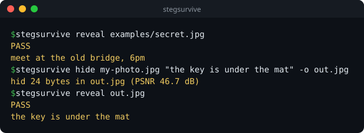
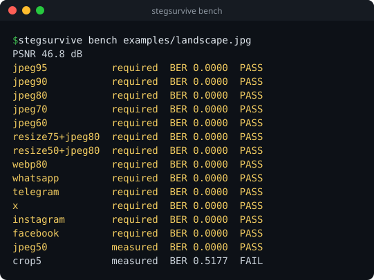
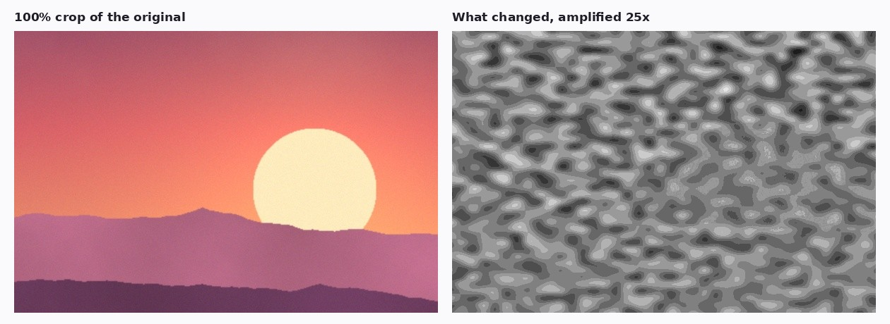

# stegsurvive

Hide a short message (up to 64 bytes) in a photo so it can still be read after WhatsApp, Instagram, X and
similar apps recompress and resize it. Classic LSB steganography loses the message at the first JPEG save;
stegsurvive is built to survive it.


*The bundled example: a 27-byte message hidden in a 2000x1250 photo, then shrunk to 1600x1000 and saved as
JPEG quality 70 (our WhatsApp-style simulation). The message comes back exactly.*


**[Try it in your browser](https://amnindersingh12.github.io/plainsight/stegsurvive.html)**: upload your own photo, hide or reveal a message. Your image never leaves the page.
## Try it in 60 seconds

**1. Install** (Python 3.10+; depends only on Pillow and numpy):

```sh
pipx install "git+https://github.com/amnindersingh12/plainsight#subdirectory=stegsurvive"
```

**2. Read the message hidden in the example image:**

```sh
curl -LO https://raw.githubusercontent.com/amnindersingh12/plainsight/main/stegsurvive/examples/secret.jpg
stegsurvive reveal secret.jpg
```

**3. Hide your own message, then read it back:**

```sh
stegsurvive hide my-photo.jpg "the key is under the mat" -o out.jpg
stegsurvive reveal out.jpg
```



**4. Send `out.jpg` through a real app** (WhatsApp, Telegram, Instagram...), save what arrives, and run
`stegsurvive reveal` on it. `PASS` means every byte came back.

**5. Check your own photo before you send it:**

```sh
stegsurvive bench my-photo.jpg
```



`bench` hides a random 64-byte message and runs it through the simulated attacks. It exits 0 when every
required attack passes.

## Usage

```
stegsurvive hide IMAGE "message" -o OUT      # OUT as .png, or .jpg (written at quality 95)
stegsurvive reveal IMAGE                     # prints the message; PASS/FAIL on stderr
stegsurvive bench IMAGE                      # simulated attack table
  --password                                 # hide/reveal: prompts for it, never on the command line
```

`reveal` exits 0 on PASS, 1 if no message is found, and 2 on errors (unreadable file, message too long,
image too flat or too small). Transparent images are flattened onto white first, as the apps do; the output is
RGB.

From Python:

```python
from PIL import Image
from stegsurvive import hide, reveal, RevealError

hide(Image.open("photo.jpg"), "meet at 6").save("out.png")
print(reveal(Image.open("received.jpg")))   # bytes, or raises RevealError
```

## Passwords

```sh
pipx install "stegsurvive[crypto] @ git+https://github.com/amnindersingh12/plainsight#subdirectory=stegsurvive"
```

- **With the `[crypto]` extra:** the message is encrypted with AES-GCM. A wrong password cannot produce
  garbage, and tampering is detected.
- **Without it:** the message is XORed with a `hashlib` keystream. That is **obfuscation, not encryption**,
  and `hide` warns you. A random per-message nonce means a password never reuses a keystream, but nothing
  detects tampering.

In both modes the password also decides which pixels carry which bit, so without it there is simply no
message to find. The key comes from scrypt with a fixed salt (64 bytes leave no room for a per-message salt),
so use a long password.

## How it works



*What hiding changes, amplified 25x: a smooth, fine texture with no blocks or edges. In this crop no pixel
moves by more than 4 of 255 levels.*

- The image is covered by a 128 x 128 grid of "chips" that stretches with the image, so resizing keeps every
  chip in place.
- Each chip gets a random +1/-1 sign. The chips are split into 819 slots of 20; each slot carries one bit.
  The signs and the grouping come from the password (or a fixed key).
- Spread-transform QIM nudges each slot's average onto the lattice for its bit. The decoder only checks which
  lattice the value sits on, so the picture underneath does not act as noise.
- The change is stronger in textured areas, weaker in flat ones, and fades out near black and white (or, on
  the retry, pure black and white are nudged 2 levels inward so they can carry it too).
- Data path: a 70-byte frame (version and mode, length, 64 data bytes, CRC32) is Reed-Solomon encoded to
  RS(102,70), which repairs up to 16 bad bytes. `reveal` needs only the received image and either returns the
  exact bytes or fails cleanly (in 20,000+ random and corrupted inputs it never
  returned a wrong message).

## Results

From `stegsurvive bench` on synthetic test images and the bundled example (short side 720 px or more,
random 64-byte payload, PSNR about 46 dB). PASS means all 64 bytes came back exactly; BER is the raw bit error
rate before error correction, worst case across the images. The platform rows are our **guesses** at each
app's pipeline (a longest-side limit and a JPEG quality), not measurements of the real apps.

| attack | required | simulated | real app |
|---|---|---|---|
| JPEG q95 / q90 / q80 / q70 / q60 | yes | PASS, BER 0.0000 | - |
| resize 75% + JPEG q80 | yes | PASS, BER 0.0000 | - |
| resize 50% + JPEG q80 | yes | PASS, BER 0.0000 | - |
| WebP q80 | yes | PASS, BER 0.0000 | - |
| WhatsApp guess (max side 1600, q70) | yes | PASS, BER 0.0000 | not tested yet |
| Telegram guess (1280, q80) | yes | PASS, BER 0.0000 | not tested yet |
| X guess (2048, q85) | yes | PASS, BER 0.0000 | not tested yet |
| Instagram guess (1080, q75) | yes | PASS, BER 0.0000 | not tested yet |
| Facebook guess (2048, q71) | yes | PASS, BER 0.0000 | not tested yet |
| JPEG q50 | measured | PASS, BER 0.0000 | - |
| crop 5% (right and bottom) | measured | FAIL, BER about 0.5 | - |

**Help fill the real-app column:** run step 4 above and open an issue with the app, platform (Android, iOS,
web) and PASS or FAIL. No result in this README comes from a real app yet.

## Capacity

64 bytes for every image size; 56 with a password but without `[crypto]` (an 8-byte nonce is stored with the
message); 36 with an AES password (nonce and tag take 28 bytes).

## Limitations

- **Crops, rotation and flips break it.** The grid has to line up; a sync search is a v2 candidate.
- **Screenshots, documents and black borders** work since 0.1.1: when pure white or black areas leave too
  little room, `hide` retries with them nudged 2 levels inward (invisible). Measured on synthetic examples:
  text-on-white screenshots at 1280x960 (38.7 dB) and 1920x1080 (38.4 dB) and a photo inside an 80% black
  border (40.0 dB) pass every required attack; a 960x720 screenshot (41.1 dB) passes all but WebP.
- **`hide` checks its own work:** a result is only accepted if the message reads back after a half-size
  JPEG 80 trip. If it reads back only from the untouched file, you get a warning; if not at all, an error.
- **Small images:** the targets assume a short side of 720 px or more. Below that `hide` warns; below 256 px
  it refuses.
- **A faint fine grain** can show on perfectly smooth areas when you compare both images side by side at 100%.
- **JPEG q50 and harsher compression are not guaranteed**, and apps change their pipelines without notice.
- **It is not hidden from steganalysis.** Statistical tools can tell that something was embedded. The goal
  is survival, not secrecy.
- **Resources:** images above 50 MP are refused; hiding in a 12 MP photo peaks at about 0.8 GB of memory.
  No video.

## Prior art

- **LSB tools** (steghide, OpenStego and similar) carry far more data, but lose it as soon as the image is
  recompressed or resized.
- **Robust watermarking** is the close relative: spread spectrum and QIM research (Cox et al.; Chen and
  Wornell; Malvar and Florencio) and tools such as `invisible-watermark`.
- **What stegsurvive adds:** a small CLI with a fixed 64-byte payload, error correction that returns the
  exact bytes or fails cleanly, optional passwords, and a benchmark you can run on your own photo.

## License

MIT
