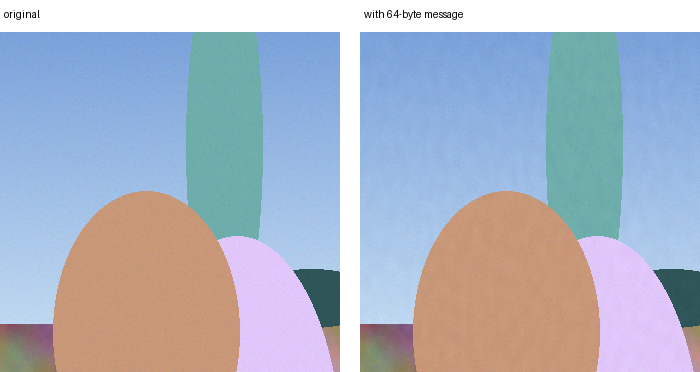

# stegsurvive

Hide a short message (up to 64 bytes) in an image so that it can still be read after the image has been recompressed and resized the way social media apps do it.



*Left: synthetic test image. Right: the same image with a 64-byte message hidden in it (PSNR 46.7 dB).*

## Install

```
pipx install "git+https://github.com/amnindersingh12/plainsight#subdirectory=stegsurvive"
pipx install "stegsurvive[crypto] @ git+https://github.com/amnindersingh12/plainsight#subdirectory=stegsurvive"   # adds AES-GCM passwords
```

Needs Python 3.10+. Its only dependencies are Pillow and numpy; `cryptography` is optional.

## Usage

```
stegsurvive hide photo.jpg "meet at 6" -o out.png      # prints: hid 9 bytes in out.png (PSNR xx.x dB)
stegsurvive reveal out.png                             # prints the message; PASS/FAIL on stderr
stegsurvive hide photo.jpg "meet at 6" -o out.png --password   # prompts; never pass it on the command line
stegsurvive reveal received.jpg --password
stegsurvive bench photo.jpg                            # simulated attack table, exit 0 if all required pass
```

Save the output as PNG, or as JPEG (written at quality 95), and then send it. `reveal` exits with 0 on PASS,
1 if no message is found, and 2 on errors such as an unreadable file or a message that is too long.

Transparent images are flattened onto white before the message goes in, and the output is RGB.
Platforms flatten transparency anyway, and doing it first means the message is written into what they will show.

Python:

```python
from PIL import Image
from stegsurvive import hide, reveal, RevealError

out = hide(Image.open("photo.jpg"), "meet at 6", password=None)   # returns a PIL image
out.save("out.png")
print(reveal(Image.open("received.jpg")))                         # bytes, or raises RevealError
```

## How it works

- The image is covered by a 128 x 128 grid of "chips" that stretches with the image, so a resize keeps every
  chip in the same place.
- Every chip has a random +1/-1 sign. The chips are split at random into 819 slots of 20 chips each, and each
  slot carries one coded bit. The grouping and the signs both come from the password, or from a fixed key if
  there is no password.
- The value of a slot is the average over its chips of the sign times the high-passed luminance.
- Dithered quantization (spread-transform QIM) moves each slot's value onto the lattice for its bit.
  Because the decoder only checks which lattice the value sits on, the picture underneath does not act as
  noise.
- The change is a smooth, band-limited pattern with no block edges.
- The pattern is stronger in textured areas and weaker in flat ones, and it fades out near black and white.
- Data path: a 70-byte frame (version/mode, length, 64 data bytes, CRC32) is Reed-Solomon encoded to
  RS(102,70), which fixes up to 16 bad bytes. That gives 816 bits.
- `reveal` needs only the received image. It re-reads the slots, decodes Reed-Solomon and checks the CRC.
  It either returns the exact bytes or fails cleanly.

## Results

The simulated column comes from `stegsurvive bench` on synthetic test images of 720 px or more on the short side (no copyrighted
photos), with a random 64-byte payload.
PASS means all 64 bytes came back exactly. BER is the raw slot error rate before error correction, worst case across
the images. PSNR on these images is about 46 dB.
The platform rows use our *guesses* at each platform's pipeline: a longest-side limit and a JPEG quality. These
guesses have not been measured against the real apps.

| attack | required | simulated (scene, plasma, fractal) | real platform |
|---|---|---|---|
| JPEG q95 / q90 / q80 / q70 / q60 | yes | PASS, BER 0.0000 | - |
| resize 75% + JPEG q80 | yes | PASS, BER 0.0000 | - |
| resize 50% + JPEG q80 | yes | PASS, BER 0.0000 | - |
| WebP q80 | yes | PASS, BER 0.0000 | - |
| WhatsApp guess (max side 1600, q70) | yes | PASS, BER 0.0000 | not tested yet |
| Telegram guess (1280, q80) | yes | PASS, BER 0.0000 | not tested yet |
| X guess (2048, q85) | yes | PASS, BER 0.0000 | not tested yet |
| Instagram guess (1080, q75) | yes | PASS, BER 0.0000 | not tested yet |
| Facebook guess (2048, q71) | yes | PASS, BER 0.0000 | not tested yet |
| JPEG q50 | measured | PASS, BER 0.0000 | - |
| crop 5% (right and bottom) | measured | FAIL, BER ~0.5 | - |

**Real platform column:** fill it in by sending the output of `stegsurvive hide` through the app, saving the
received image, and running `stegsurvive reveal` on it, which prints PASS or FAIL. No result in this
README comes from a real platform yet.

In the test suite, a perfectly smooth synthetic gradient also passes every required attack. Its worst case
is 2 of 816 bits wrong after WebP q80, well within what Reed-Solomon corrects.

## Capacity

The capacity is 64 bytes for every image size. With an AES password it drops to 36 bytes, because the
12-byte nonce and 16-byte tag use 28 of the 64. With a password but without the `[crypto]` extra it is
56 bytes, because an 8-byte random nonce is stored with the message.

## Passwords

- **With `stegsurvive[crypto]` installed:** the message is encrypted with AES-GCM, so a wrong password
  cannot produce garbage.
- **Without it:** the message is XORed with a keystream from `hashlib`, which is **obfuscation, not
  encryption**. `hide` prints a warning when this happens. A random nonce per message means the same
  password never reuses a keystream, but nothing detects tampering.

In both modes the password also changes which chips form which slot, so a wrong or missing password simply
finds no message. A header flag records which mode was used. Revealing an AES message without the extra
fails with `pip install stegsurvive[crypto]`.

The key comes from scrypt with a fixed salt, because 64 bytes leave no room for a per-message salt. That
means a weak password can be precomputed: use a long one.

## Limitations

- **Crops, rotation and flips break it.** The grid has to line up. A sync search over offsets is a v2
  candidate.
- **Screenshots and images with large pure white or black areas are weak.** Those areas are left
  untouched, because darkening them would show, so only the text strokes can carry the message. On the
  synthetic text-on-white test image:
  - At 960x720, `hide` refuses it ("too flat").
  - At 1280x960 (PSNR 38.9 dB), it passes every required attack.
  - At 1920x1080 (PSNR 39.1 dB), it passes JPEG q60-95, WebP q80, Telegram, X and Facebook, but fails
    resize 50%, WhatsApp and Instagram.
- **Flat and small images are weaker.** On perfectly smooth areas, a faint fine grain can be seen when you
  compare the two images side by side at 100%. The robustness targets assume a short side of 720 px or
  more. Below that you get a warning, and below 256 px `hide` refuses the image.
- **JPEG q50 and harsher compression are not guaranteed.**
- **The platform pipelines are guesses.** Apps change their settings without notice.
- **It is not hidden from steganalysis.** Statistical tools can detect that something was embedded. The
  goal is survival, not secrecy.
- **No video.** Images above 50 MP are refused. Hiding in a 12 MP photo peaks at about 0.8 GB of memory (6 s on a 2-core VM).

## Prior art

- **Classic LSB tools** (steghide, OpenStego and similar) hide much more data, but the message is
  lost as soon as the image is recompressed or resized.
- **Robust watermarking** is the close relative. This includes research on spread spectrum and QIM
  (Cox et al.; Chen and Wornell; Malvar and Florencio) and tools such as `invisible-watermark` / `imwatermark`.
- **What stegsurvive adds** is a small tool with a fixed 64-byte payload, error correction that either returns
  the exact bytes or fails cleanly, optional passwords, and a benchmark table showing which simulated
  pipelines it survives.

## License

MIT
