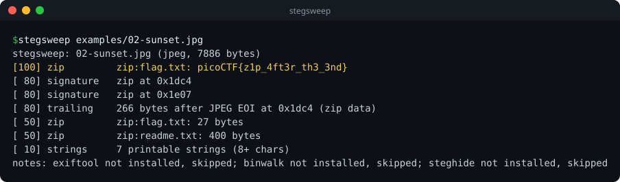
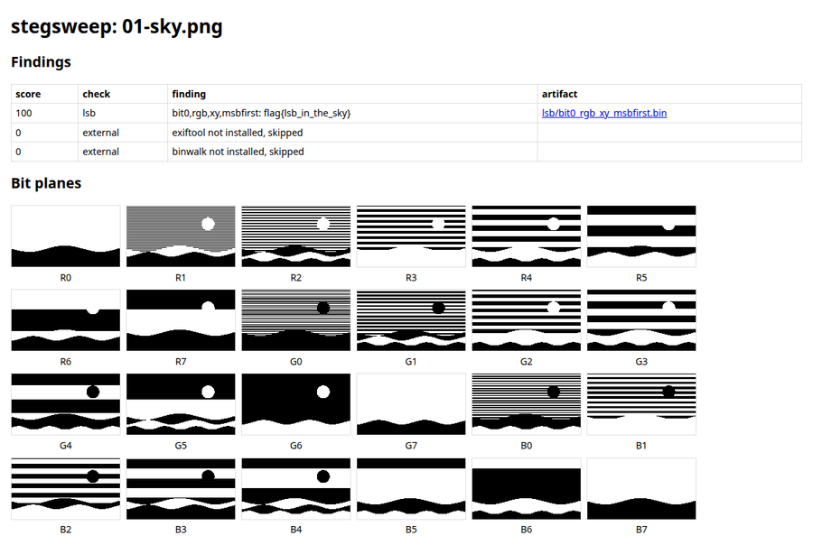

# stegsweep

One command, every first steg check. `stegsweep` takes a CTF file (image, audio or anything else), runs the checks
you would otherwise run by hand with zsteg, stegsolve, binwalk, exiftool, strings and steghide, and lists the
likely flags first.



- Local and offline: nothing is uploaded.
- One dependency (Pillow). External tools are used when installed and skipped when not.
- Safe with hostile files: size caps, zip-bomb caps, no shell, extracted data is never executed.

## Install

```
pipx install "git+https://github.com/amnindersingh12/plainsight#subdirectory=stegsweep"
```

Python 3.10+. Or with pip in a virtual environment: `pip install "git+https://github.com/amnindersingh12/plainsight#subdirectory=stegsweep"`.

## Solve your first challenge

The repo ships five practice files in [`examples/`](examples/), each hiding a flag a different way.

**1. Get the examples.**

```
git clone https://github.com/amnindersingh12/plainsight
cd plainsight/stegsweep
```

**2. Sweep a file.** Findings are ranked by score: 100 is a flag, 80 a hidden file, 50 readable text,
10 background information. Notes say what was skipped.

```
$ stegsweep examples/01-sky.png
stegsweep: 01-sky.png (png, 2624 bytes)
[100] lsb         bit0,rgb,xy,msbfirst: flag{lsb_in_the_sky}
notes: exiftool not installed, skipped; binwalk not installed, skipped
```

`bit0,rgb,xy,msbfirst` is where the flag came from: bit 0 of the R, G and B values, pixels read row by row, bits
packed most significant first (zsteg calls this `b1,rgb,lsb,xy`).

**3. Get the full report.** `-o DIR` saves every extracted stream and a static HTML report with all bit planes.

```
$ stegsweep examples/01-sky.png -o report
stegsweep: 01-sky.png (png, 2624 bytes)
[100] lsb         bit0,rgb,xy,msbfirst: flag{lsb_in_the_sky}
notes: exiftool not installed, skipped; binwalk not installed, skipped
report: report/index.html
```

Open `report/index.html` in a browser:



The raw stream is in `report/lsb/bit0_rgb_xy_msbfirst.bin`:

```
$ xxd report/lsb/bit0_rgb_xy_msbfirst.bin | head -2
00000000: 666c 6167 7b6c 7362 5f69 6e5f 7468 655f  flag{lsb_in_the_
00000010: 736b 797d 0000 0000 0000 0000 0000 0000  sky}............
```

**4. Try the rest.** Each one exercises a different check:

```
$ stegsweep examples/03-night.png
stegsweep: 03-night.png (png, 2497 bytes)
[100] metadata    Comment: CTF{c0mpr3ss3d_c0mm3nts}
[ 50] metadata    Author: night owl
[ 10] strings     4 printable strings (8+ chars)
notes: exiftool not installed, skipped; binwalk not installed, skipped

$ stegsweep examples/04-beep.wav
stegsweep: 04-beep.wav (wav, 16044 bytes)
[100] wav-lsb     wav,bit0,msbfirst: flag{l1st3n_t0_th3_l0w_b1ts}
[ 10] strings     1 printable strings (8+ chars)
notes: exiftool not installed, skipped; binwalk not installed, skipped; steghide not installed, skipped
```

`examples/02-sunset.jpg` (shown at the top) and `examples/05-mountains.jpg` are left for you. Hints and answers
are in [`examples/README.md`](examples/README.md).

## Usage

```
stegsweep FILE [-o DIR] [--wordlist FILE] [--flag-format REGEX]
```

| Option | What it does |
|---|---|
| `FILE` | The file to triage. |
| `-o DIR`, `--output DIR` | Save extracted data, bit-plane images and `DIR/index.html`. Without `-o` nothing is written to disk. |
| `--wordlist FILE` | Passphrase list for stegseek, for example `rockyou.txt`. |
| `--flag-format REGEX` | What a flag looks like, for example `'myctf\{.*?\}'`. The default matches `flag{...}`, `picoCTF{...}`, `DUCTF{...}`, `HTB{...}`, `THM{...}` and any `<prefix>ctf{...}`. |

The terminal shows at most 15 ranked findings; the report has all of them. Exit code 0 means the sweep ran, 2
means bad arguments or an unreadable input.

## What it checks

| Check | Finds | Files |
|---|---|---|
| Metadata | Flags and text in PNG `tEXt`/`zTXt`/`iTXt` chunks, JPEG comments, XMP and EXIF (including UTF-16 `XP*` tags and `UserComment`). | images |
| Trailing data | Bytes after the PNG `IEND` chunk or the JPEG end-of-image marker (found by walking the file structure, so EXIF thumbnails do not count). | PNG, JPEG |
| Embedded files | zip, png, jpg, pdf, 7z, gzip and ELF signatures anywhere in the file, carved to the next signature (a zip to its end record). | any |
| Inside zips | Every member of an embedded zip, opened in memory and searched for flags; encrypted members are listed with a cracking hint. | any |
| Strings | Printable text and flags in the raw bytes. | any |
| PNG structure | CRC mismatches, unknown chunks, truncation. | PNG |
| LSB sweep (zsteg-style) | Every channel order, bits 0, 1 and 2 on their own and bits 0-1 together (3- and 4-channel orders), row or column order, MSB- or LSB-first packing; each stream is checked for flags, file signatures and readable text. | lossless images |
| WAV LSB | The same for the low bit of each audio sample. | WAV |
| Bit planes (stegsolve-style) | All 8 planes of every channel saved as images in the report. | images (with `-o`) |

## Optional external tools

stegsweep uses these when they are on your `PATH` and notes when they are not. They run without a shell, with a
120 s timeout, and their output is read, never executed.

| Tool | Adds | Runs on | Install (Debian/Ubuntu) |
|---|---|---|---|
| [exiftool](https://exiftool.org/) | Complete metadata. The file goes in on stdin, so a crafted file name cannot trigger CVE-2022-23935 (exiftool < 12.38). | any file | `apt install libimage-exiftool-perl` |
| [binwalk](https://github.com/ReFirmLabs/binwalk) | `binwalk -e` extraction. Needs `-o`, and only runs on binwalk 2.3.4 or newer (CVE-2022-4510). | any file | `apt install binwalk` (check `binwalk --help` shows 2.3.4+) or the binwalk releases page |
| [steghide](https://steghide.sourceforge.net/) | Extraction with an empty passphrase. | JPEG, BMP, WAV | `apt install steghide` |
| [stegseek](https://github.com/RickdeJager/stegseek) | Fast steghide passphrase cracking with `--wordlist`. | JPEG, BMP, WAV | `.deb` from the stegseek releases page |

## Safety with untrusted files

CTF files are made by strangers, so stegsweep treats every input as hostile:

- Inputs over 200 MiB and images over 40 megapixels are refused before decoding.
- Only PNG, JPEG, GIF, BMP, TIFF and WebP are decoded (never formats that call Ghostscript).
- Each extracted file is capped at 50 MiB, zip members are read with a running cap (zip bombs stop at the cap),
  and total carved data is capped too.
- Saved files get generated names inside `DIR`, so names from inside the file cannot escape it.
- Everything printed or written to the report is escaped, so a file cannot inject terminal codes or HTML.

## Limitations

- The LSB sweep reads the first 1 MiB of each configuration; a 12-megapixel RGBA image takes about 14 s.
- 16-bit images are reduced to 8 bits first, so their LSBs are not checked.
- No JPEG DCT-domain detection except through steghide or stegseek.
- Ranking is a heuristic: a high score means "look here first", not proof.
- Reusing an `-o` directory leaves files from earlier runs on disk; the report lists only the current run.

## Prior art

stegsweep runs the common first checks in one go. For deeper work, the dedicated tools are better:

- [zsteg](https://github.com/zed-0xff/zsteg): the LSB sweep this follows, with more configurations (Ruby).
- [stegsolve](https://github.com/zardus/ctf-tools/tree/master/stegsolve): interactive bit-plane viewer (Java).
- [binwalk](https://github.com/ReFirmLabs/binwalk): full embedded-file carving and extraction.
- [exiftool](https://exiftool.org/): complete metadata reading.
- [steghide](https://steghide.sourceforge.net/) and [stegseek](https://github.com/RickdeJager/stegseek):
  extraction and fast passphrase cracking for steghide.
- [pngcheck](http://www.libpng.org/pub/png/apps/pngcheck.html): thorough PNG structure checks.
- [Aperi'Solve](https://www.aperisolve.com/): runs many of these as a website; the file has to be uploaded.

## Development

```
cd stegsweep
python -m venv .venv && .venv/bin/pip install -e .
.venv/bin/python -m unittest discover -s tests
.venv/bin/python examples/make_examples.py   # regenerate the practice files
```

## See also

- [unseen](../unseen): scan text and code for invisible Unicode used in AI prompt injection.
- [stegsurvive](../stegsurvive): hidden messages that survive social media recompression.

## License

MIT
